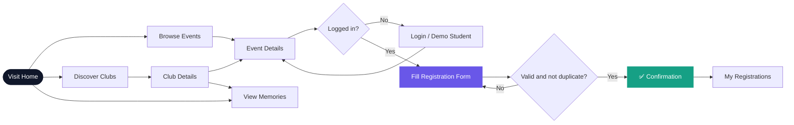
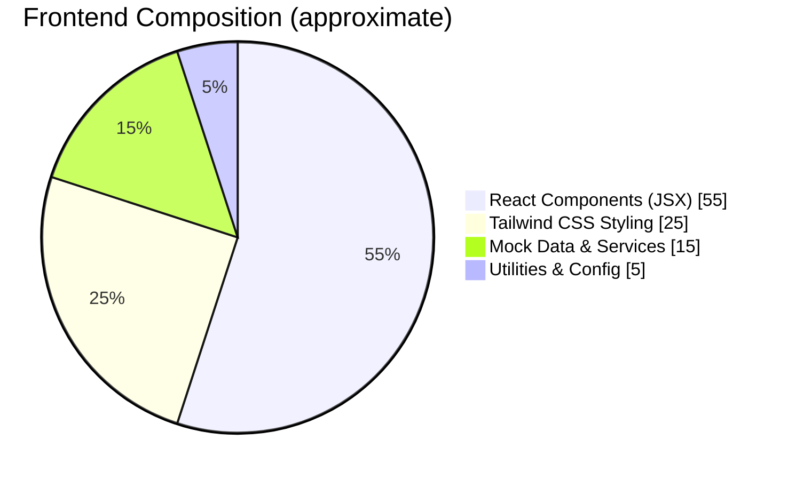
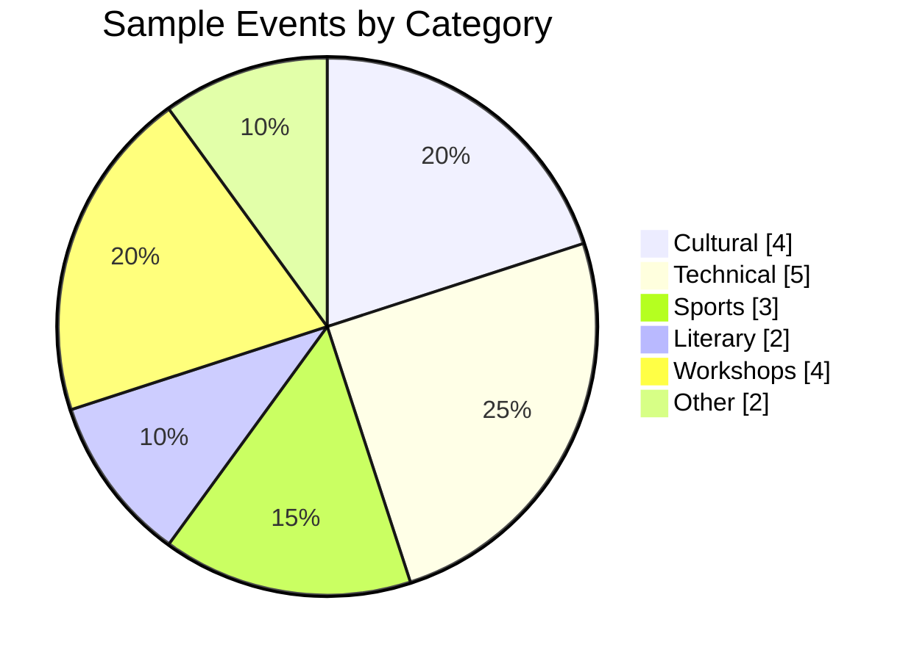
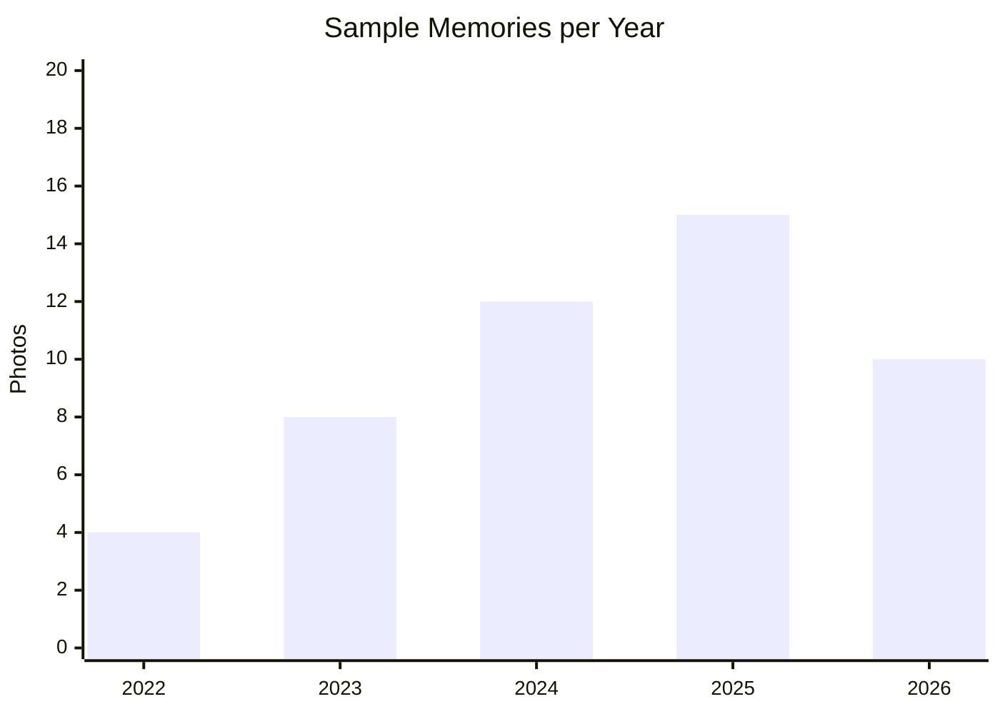
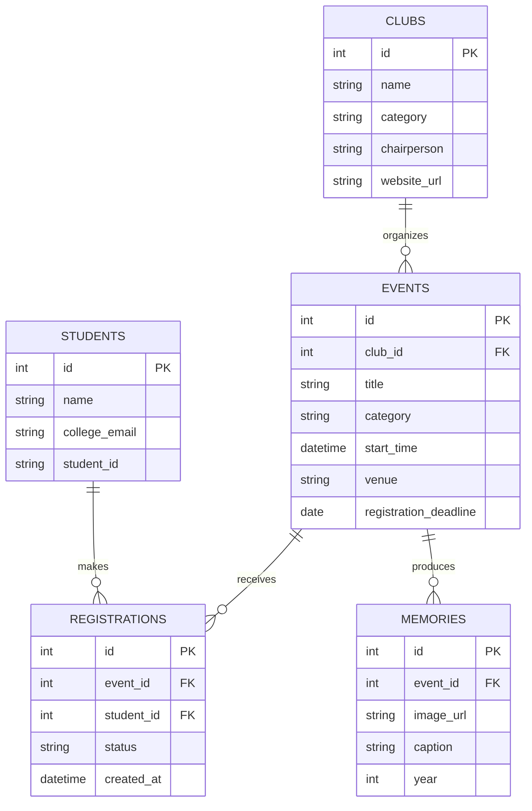
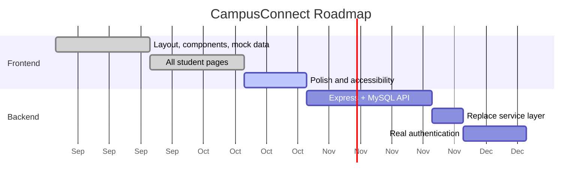

<div align="center">


<br/>


**A modern, responsive college portal to discover events, join clubs, register in seconds, and relive campus memories.**

[Features](#-features) · [Pages](#-pages) · [Quick Start](#-quick-start) · [Structure](#-project-structure) · [Backend Plan](#-backend-integration-plan) · [Roadmap](#-roadmap)

</div>

---

## 📖 About

**CampusConnect** is a student-facing, frontend-only campus portal. Students can browse upcoming and past events, register with a validated form, explore clubs, and browse a gallery of event memories — all powered by local mock data and `localStorage`.

> 💡 The project name is a placeholder. Rename it anywhere you like (navbar, footer, `index.html`, this README).

The codebase is intentionally structured around a **service layer**, so replacing mock data with a **Node.js + Express.js + MySQL** REST API later takes minimal changes.

---

## ✨ Features

| | Feature | Description |
|---|---|---|
| 🏠 | **Homepage** | Hero, featured events, club previews, memories preview, live stats |
| 📅 | **Events** | Search, category filters, Upcoming/Past tabs, date sorting, empty states |
| 📝 | **Registration** | Validated form, success confirmation, duplicate prevention |
| 🎟️ | **My Registrations** | View registered events and their status |
| 🏛️ | **Clubs** | Searchable, filterable directory with detailed club pages |
| 📸 | **Memories** | Gallery with category and year filters plus a detail view |
| 🔐 | **Login (simulated)** | Email/password UI and a one-click Demo Student Login |
| 📱 | **Responsive** | Desktop, tablet and mobile layouts |
| ♿ | **Accessible** | Labels, keyboard navigation, visible focus states |
| 🖼️ | **Image fallbacks** | Graceful placeholders if an image URL fails |

---

## 🎨 Design System


| Token | Hex | Used for |
|---|---|---|
| Midnight Navy | `#10172A` | Navbar, footer, headings, primary text |
| Electric Violet | `#6957E8` | Primary buttons, links, highlights |
| Teal | `#16A085` | Success states, "Open" badges, accents |
| Soft Background | `#F4F6FB` | Page background |
| White | `#FFFFFF` | Cards and surfaces |

**Typography:** Inter (or Manrope) · **Style:** white cards, subtle borders, soft shadows, rounded corners, gentle hover transitions.

<details>
<summary><b>Suggested Tailwind config</b></summary>

```js
// tailwind.config.js
export default {
  content: ["./index.html", "./src/**/*.{js,jsx}"],
  theme: {
    extend: {
      colors: {
        navy: "#10172A",
        violet: { DEFAULT: "#6957E8" },
        teal: { DEFAULT: "#16A085" },
        soft: "#F4F6FB",
      },
      fontFamily: { sans: ["Inter", "Manrope", "system-ui", "sans-serif"] },
    },
  },
  plugins: [],
};
```

</details>

---

## 🖥️ Pages


> 📌 Replace this illustration with real screenshots once you run the app (see [Screenshots](#-screenshots)).

| Route | Page | Highlights |
|---|---|---|
| `/` | Home | Hero, featured events, clubs, memories, stats, footer |
| `/events` | Events | Search, filter, tabs, sort, cards with status badges |
| `/events/:id` | Event Details | Cover image, info, deadline, registration form |
| `/my-registrations` | My Registrations | Registered events with status |
| `/clubs` | Club Directory | Search and category filter |
| `/clubs/:id` | Club Details | Banner, chairperson, events, memories, website link |
| `/memories` | Memories | Gallery, category/year filters, detail view |
| `/login` | Login | Simulated login and demo student account |
| `*` | Not Found | Friendly fallback with link home |

### 🧭 User Flow



---

## 🚀 Quick Start

**Prerequisites:** Node.js 18+ and npm.

```bash
# 1. Clone the repository
git clone <your-repo-url>
cd <project-folder>

# 2. Install dependencies
npm install

# 3. Start the dev server
npm run dev        # Vite  (use `npm start` if you used Create React App)

# 4. Build for production
npm run build
npm run preview
```

Open the local URL printed in your terminal (Vite default: `http://localhost:5173`).

### 🔑 Demo Login

No real authentication exists. Click **Demo Student Login** on `/login`, or enter any valid-looking college email and a password. Passwords are **never** stored.

---

## 🧰 Tech Stack



| Layer | Technology |
|---|---|
| UI | React.js (JavaScript / JSX) |
| Styling | Tailwind CSS |
| Routing | React Router |
| State | React hooks, Context API |
| Persistence (demo) | `localStorage` — registrations and UI preferences only |
| Data | Local mock files in `src/data` |

---

## 📊 Mock Data Overview



> Update these numbers to match your actual `src/data/events.js`.



---

## 🗂️ Project Structure

```text
src/
├── assets/                 # Logos, fallback images
├── components/             # Reusable UI
│   ├── Navbar.jsx
│   ├── Footer.jsx
│   ├── EventCard.jsx
│   ├── ClubCard.jsx
│   ├── MemoryCard.jsx
│   ├── SearchBar.jsx
│   ├── CategoryFilter.jsx
│   ├── StatusBadge.jsx
│   ├── RegistrationForm.jsx
│   └── ImageWithFallback.jsx
├── pages/
│   ├── Home.jsx
│   ├── Events.jsx
│   ├── EventDetails.jsx
│   ├── MyRegistrations.jsx
│   ├── Clubs.jsx
│   ├── ClubDetails.jsx
│   ├── Memories.jsx
│   ├── Login.jsx
│   └── NotFound.jsx
├── data/                   # Mock data (events, clubs, memories, stats)
├── services/               # 🔌 Data-access layer (swap for API calls later)
│   ├── eventService.js
│   ├── clubService.js
│   ├── memoryService.js
│   ├── registrationService.js
│   └── authService.js
├── context/                # Auth / app context
├── hooks/                  # Custom hooks (e.g. useLocalStorage)
├── utils/                  # Validators, date formatters, constants
├── App.jsx                 # Routes
├── main.jsx                # Entry point
└── index.css               # Tailwind directives
```

> Adjust file names if your actual structure differs.

---

## 🔌 Backend Integration Plan

Pages and components **never** import mock data directly — they call the service layer. To go live, only the files in `src/services/` need to change.


**Today (mock):**

```js
// src/services/eventService.js
import { events } from "../data/events";

export async function getEvents() {
  return events;
}
```

**Later (REST API):**

```js
// src/services/eventService.js
const API_URL = import.meta.env.VITE_API_URL;

export async function getEvents() {
  const res = await fetch(`${API_URL}/events`);
  if (!res.ok) throw new Error("Failed to load events");
  return res.json();
}
```

### Planned REST Endpoints

| Method | Endpoint | Purpose |
|---|---|---|
| `GET` | `/api/events` | List events (query: `category`, `status`, `q`) |
| `GET` | `/api/events/:id` | Event details |
| `POST` | `/api/events/:id/register` | Register for an event |
| `GET` | `/api/registrations/me` | Current student's registrations |
| `GET` | `/api/clubs` | List clubs |
| `GET` | `/api/clubs/:id` | Club details |
| `GET` | `/api/memories` | List memories (query: `category`, `year`) |
| `POST` | `/api/auth/login` | Authenticate student |

### Suggested MySQL Tables



---

## 🔒 Privacy & Security Notes

- ✅ `localStorage` holds **only** demo registrations and non-sensitive UI preferences.
- ❌ Passwords are **never** stored or processed.
- ❌ No real authentication — all login logic is simulated in `authService.js`.
- 🔁 Replace the simulated login with secure, server-side authentication (e.g. JWT in httpOnly cookies) when the backend arrives.

---

## 📷 Screenshots

Add real screenshots after running the app:

| Home | Events | Event Details |
|---|---|---|
| `docs/images/home.png` | `docs/images/events.png` | `docs/images/details.png` |

| Clubs | Memories | Login |
|---|---|---|
| `docs/images/clubs.png` | `docs/images/memories.png` | `docs/images/login.png` |

Then embed them like this:

```md

```

---

## 🗺️ Roadmap



- [x] Shared layout and reusable components
- [x] Events, clubs, memories, login pages
- [x] Registration with validation and duplicate prevention
- [ ] Connect Node.js + Express + MySQL backend
- [ ] Real authentication
- [ ] Admin dashboard for organizers
- [ ] Email confirmations and reminders

---

## 🤝 Contributing

1. Fork the repo and create a branch: `git checkout -b feature/your-feature`
2. Keep components reusable and Tailwind-only (no inline style sprawl).
3. Don't import mock data inside components — go through `src/services`.
4. Commit with clear messages and open a pull request.

---

## 📬 Contact

| | |
|---|---|
| 👤 Maintainer | *Your Name* |
| 📧 Email | `your.email@college.edu` |
| 🌐 Website | `https://example.edu` |

> All contact details are placeholders — replace them with your own.

---

<div align="center">

Made with 💜 for the campus community

**[⬆ Back to top](#)**

</div>
